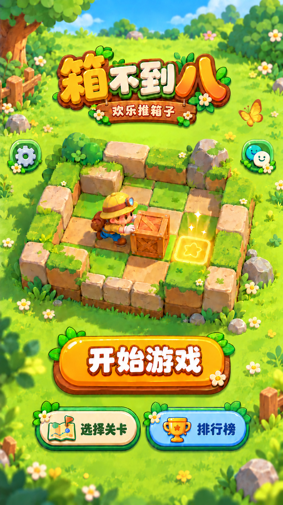

# 视觉规范 v1

状态：用户已确认首页视觉母版；运行时迁移待完成。确认日期：2026-10-20。

本文件是全项目新视觉的唯一规范入口。首页以本文件和下方母版共同为准；其他页面继承材质、色彩和组件语言，具体布局需分别验收。历史截图、旧提示词及旧代码不能覆盖已确认的设计。

## 已确认母版

[打开母版原图](../images/visual-v1/reference/home-master-v1.png)

- 原始 PNG：941 × 1672 像素，2,145,484 字节；保留生成原件，未插值放大。
- SHA-256：`3ff438906be98577e64b9985fbb87c138d19cdf241600250f146a18a8f177c52`。
- 来源：本次视觉专项中最终确认的“去掉左右图标下方底带”版本。
- 这是设计参考图，不能作为包含按钮和文字的整屏运行时背景，也不是已拆分透明图集。
- 如需更高分辨率交付，应单独生成并复核资产；当前不能宣称已有 2K/4K 母版。

## 风格与材质

整体为阳光草地中的 2.5D 手绘卡通益智世界：温暖、明亮、圆润，有自然空间层次。

- 环境：草地、花朵、灌木、圆润砂岩、少量木质构件；边缘较丰富，交互与棋盘内部保持清楚。
- 棋盘：保留母版微缩场景的透视、自然石墙和前后层次。不得擅自改成平面棋盘、密集围城或重新增删石墙。
- 人物：黄色探险帽与头灯、蓝色服装、棕色背包和靴子；角色双手接触木箱，目标格清晰可见。
- 光照：主光从左上方照入，右下方形成柔和投影；各资产的受光方向和接触阴影一致。
- UI：奶油色面板、绿色边缘、暖黄主按钮，采用适度厚度与柔和高光。深色边缘用于区分层次，避免统一纯黑粗描边。
- 保留木头、石头和草地之间的材质差异；避免高光过强的塑料质感、像素画、通用网页卡片。

## 色彩与文字

以下 HEX 是后续代码化的建议起点，不是对生成图的逐像素取色；最终以母版观感及实机可读性验收。迁移时新增语义 token，不直接全局替换旧主题键。

| 语义 | 建议色 | 使用 |
| --- | --- | --- |
| 深绿 | `#245A36` | 次级文字、组件边缘 |
| 叶绿 | `#75B940` | 环境、状态强调 |
| 奶油白 | `#FFF2CE` | 次按钮、浅色图标 |
| 暖黄 | `#FFD449` | 主按钮亮面 |
| 橙色 | `#F2A21B` | 主按钮厚度、受光变化 |
| 木棕 | `#874326` | 木质边缘、暖色文字轮廓 |
| 浅蓝 | `#8EDBFA` | 排行榜按钮 |
| 深蓝 | `#174E7A` | 排行榜文字 |

- 固定文案：`箱不到八`、`欢乐推箱子`、`开始游戏`、`选择关卡`、`排行榜`。
- Logo 为独立艺术字资产；按钮文案优先用代码绘制，必须核对与母版的字重、轮廓及居中关系。
- 以 414 逻辑像素宽为实现参考：主按钮字号可从 32–36、二级按钮从 20–24 起调；这些是实施建议，不是已验收尺寸。
- 中文不可缺字、错字或压缩变形；字体加载失败必须有可读回退。不能将截图中的文字失真当成标准。

## 首页信息层级与布局

1. 顶部：预留资源信息空间；右上微信系统胶囊区域为系统占用区。
2. Logo 与副标题：位于顶部留白下方。
3. 中部：母版微缩推箱场景，为主要展示内容。
4. 左右工具入口：左设置、右游戏圈，保留母版位置、配色和紧凑造型；无下垂底带、长导轨、木桩、木牌或石牌。
5. 下部：唯一主按钮“开始游戏”。
6. 主按钮下方：等尺寸的“选择关卡”和“排行榜”，后者使用奖杯与浅蓝色强调。

排行榜为二级核心入口，不能降回底部小工具图标。设置和游戏圈不移入底部，不另造右上胶囊。

未来体力、签到、活动仅预留空间和扩展规则，当前不显示假数值、空按钮槽或未上线入口。侧边新增入口需复核场景遮挡；建议每侧最多两个，更多活动汇总到活动入口。此数量是扩展建议，尚未完成视觉验收。

## 适配与交互规则

- 母版比例约 9:16，不直接将整屏图片拉伸到所有设备。
- 按微信实际胶囊边界、顶部及底部安全区计算布局；不得用母版像素坐标假设所有机型一致。
- 背景可裁切，Logo、场景、按钮和图标保持各自宽高比。短屏优先调整留白及场景尺度，不能让点击区域相互覆盖。
- 触控区建议至少 44 × 44 逻辑像素；不足时扩大透明命中区并检查相邻入口。
- 主按钮按下轻微下沉约 2–4 逻辑像素并收缩阴影；避免大幅跳动或脉冲改变布局。
- 原生游戏圈按钮与视觉资产及命中区域一致，只在首页可交互时显示。自定义图显示和跳转需实机验证。
- 母版是静态构图标准。角色推箱、目标闪光等动画应分层实现，禁止用整块场景摇晃替代人物动作。

## 资产目录与交付

新视觉统一放在项目根目录 `images/visual-v1/`，与 `assets/` 旧资源区分。

| 目录 | 用途 | 当前状态 |
| --- | --- | --- |
| `reference/` | 已确认母版及参考元数据；不进运行时包 | 已归档 |
| `home/` | 首页背景、透明 UI 和场景分层 | 待生成 |
| `shared/` | 后续跨页面共用的组件资产 | 待生成 |

资产拆分详见 [首页资产清单](home-assets.md)。未来云端目录若启用，使用独立的 `images/visual-v1/` 命名空间；本地存在不表示云端已上传。文件名必须带版本号，替换版本需更新引用及包配置。

## 旧风格处理与迁移边界

| 对象 | 定位 | 后续处理 |
| --- | --- | --- |
| 本文件与母版 | 已确认新视觉标准 | 所有新设计引用这里 |
| `docs/主界面.html` | 历史原型 | 仅作历史对照，不作为生成基线 |
| `output/imagegen/` 中旧提示词与草稿 | 历史过程资料 | 不作为当前规范 |
| `src/ui/theme.js` | 旧运行时 token | 按组件逐步迁移，不代表新规范 |
| `src/pages/home/` 与 `src/ui/home-icons.js` | 当前旧首页实现 | 待按母版迁移布局、资产与文字 |
| `assets/` 及现有云图片 | 旧运行时依赖 | 保留至调用方迁移并通过验证 |

本次完成规范归一和母版归档，不宣称运行时新旧风格已全部消除。迁移时逐页处理：先首页，再模式/选关、排行榜与弹窗、游戏页；每页都要有实机截图验收。不得删除仍被代码引用的旧资产。

## 验收标准

- 参照母版检查构图、层级、字体、材质、角色与场景关系，尤其保持无底带的左右图标。
- 透明资产具有真实 alpha，无棋盘格底图、白边、裁断阴影；记录实际尺寸与可见区域。
- 检查每个运行时引用及打包规则，避免只生成文件却仍加载旧图；母版参考图不得进入发布包。
- 分别记录静态检查、开发者工具、体验版和真机验证结果。当前仅母版与规范已确认，透明素材、运行时接入和实机验收均待完成。
